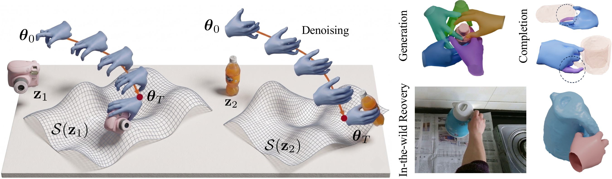

# HaNDF: Object-Conditioned Geometric Neural Hand Distance Fields

Official code and weights for the NeurIPS 2026 paper.
[Project page](https://circle-group.github.io/research/HaNDF/)




The prior can be applied to many hand-related tasks, such as hand-object interaction, hand generation, hand denoising, and hand completion. It can be used to refine hand poses directly or serve as a regularizer during network training.

## Install

```bash
pip install torch numpy pyyaml

# for the m2m metric
pip install git+https://github.com/hassony2/manopth
```

m2m calculation also needs the MANO hand model. Register at
[mano.is.tue.mpg.de](https://mano.is.tue.mpg.de/) and put `MANO_RIGHT.pkl` in `mano/models/` at the
root of this repo. If you keep MANO somewhere else, pass its directory
as `--mano-root`.

## Quick start

Project 8 noisy hands onto the grasp manifold of one object:

```bash
python handf_infer.py --code weights/object_codes/Mug__046.pt
# Mug__046.pt: predicted distance before 0.1638 -> after 0.0023 rad (mean of 8 poses)
```

Evaluate the denoising accuracy on the included test set:

```bash
python eval_testset.py
# dq  : 11.8033 -> 5.5198 deg
# m2m : 11.1595 -> 6.4372 mm
```

Train from scratch:

```bash
python train.py                                                    # full recipe, 2000 epochs
python train.py --max-epoch 3 --epoch-size 4096 --batch-size 512   # smoke test
```

## Pose representation

Each hand pose is a point on a product manifold of unit quaternions, one quaternion per joint, and
the distance field is learned with respect to the geodesic distance on this manifold.

In code a pose is `(B, 15, 4)` float32: the 15 MANO finger joints as unit quaternions `(w, x, y, z)`,
in the `flat_hand_mean=True` convention (full rotations, not PCA offsets). Convert from MANO
axis-angle with `aa_to_quat`, which accepts `(N, 45)` or `(N, 48)`.

An object is a single 64-d DeepSDF code. `weights/object_codes/` holds 300 of them, one per HOI4D
object across the six categories.

## Projection

`project()` moves a pose onto the object's grasp manifold by Riemannian gradient descent: a unit
quaternion may only move tangentially, so the Euclidean gradient is projected onto the tangent space
of each joint's sphere and applied by exponential map, keeping every joint a valid rotation without
renormalising.

```python
from handf_infer import load_handf, load_code, distance, project
import torch

dev = torch.device('cuda:0')
model = load_handf(dev)
code = load_code('weights/object_codes/Mug__046.pt').unsqueeze(0).expand(B, -1)

d = distance(model, hand, code, dev)                  # (B,) distance to the manifold, radians
out = project(model, hand, code, dev)                 # (B, 15, 4) projected pose
out = project(model, hand, code, dev, mask=mask)      # mask (B, 15) bool: True = update this joint
```

Defaults are 500 steps, step size 2.0, un-normalised gradient. Joints left out of `mask` keep their
input rotation.

## Results

`eval_testset.py` compares the denoised pose with the ground truth and averages over the test set:
**dq**, the RMS-over-15-joints geodesic distance in degrees, and **m2m**, the distance between the
two MANO hands in mm.

| | dq (deg) | m2m (mm) |
|---|---|---|
| noisy input, sigma = 0.8 | 11.8033 | 11.1595 |
| **after projection** | **5.5198** | **6.4372** |

3,000 test poses over 30 held-out objects, 500 projection steps.

## Data

Hand poses are derived from [HOI4D](https://hoi4d.github.io/) over six categories (Bottle, Bowl,
Kettle, Knife, Mug, ToyCar) and filtered by hand–object contact. Objects are split by instance:
`N46`–`N50` of every category are held out for testing and never appear in training, which uses 186
objects over the six categories.

`testset/` is a frozen draw of 3,000 test-split poses, each corrupted by rotating its joints about a
random axis through a geodesic angle drawn from Exp(0.8) (seed 0).

## Training

`train.py` implements the training recipe described in the paper:

| | |
|---|---|
| noise | geodesic angle h ~ Exp(0.8) about a random axis, half of each batch restricted to 1–4 whole fingers |
| label | exact geodesic distance to the nearest clean pose of the same object |
| loss | `L1(predicted, label)` |
| optimiser | AdamW 1e-4, cosine schedule to 1e-6, gradient clip 1.0 |
| schedule | 2000 epochs x 12 steps x batch 8192, seed 4 |

`train.py` writes a checkpoint every 500 epochs, and the released weights are simply the last one.
No validation set is used to choose between them. An earlier checkpoint may well perform better.
Holding out a validation split and selecting on it is likely to improve the numbers above.

## TODO

- Release the DeepSDF weights and the processing code to fit a new mesh.

## Citation

```bibtex
@inproceedings{liu2026handf,
  title     = {{HaNDF}: Object-Conditioned Geometric Neural Hand Distance Fields},
  author    = {Liu, Zuhao and Darcan, Melih and Yu, Zhengdi and Guler, Riza Alp and Birdal, Tolga},
  booktitle = {Advances in Neural Information Processing Systems (NeurIPS)},
  year      = {2026}
}
```

## License

CC BY-NC 4.0, see [LICENSE](LICENSE). Non-commercial use only, which is inherited from the material
this work builds on: the hand poses come from HOI4D (CC BY-NC 4.0) and the Riemannian descent code
from NRDF (non-commercial research license).

## Acknowledgements

We thank the authors of NRDF, Pose-NDF, EasyHOI, AlignSDF, HMP, iHOI, HaMeR, LatentHOI, Text2HOI, HOI4D, G-HOP, DexYCB and OakInk for
providing their code and data.
